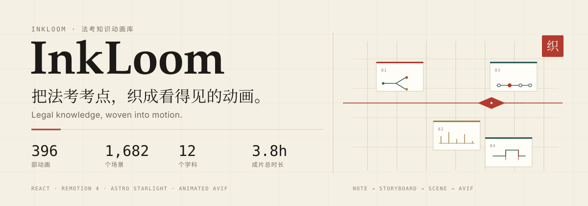
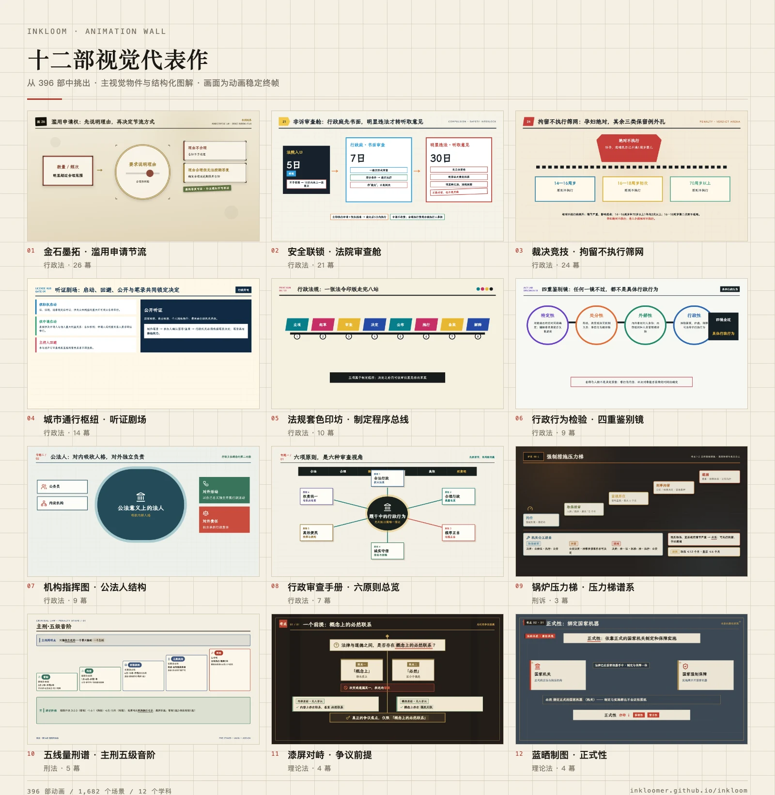

<a id="top"></a>
<p align="center">
  
</p>

<p align="center">
  <b>面向法考的知识动画库</b>：每一部动画只讲一个考点，把它拆成可播放的语义场景。<br>
  <sub><a href="#zh">中文</a> · <a href="#english">English</a> · <a href="#wall">动画墙</a> · <a href="#catalog">完整目录</a> · <a href="https://inkloomer.github.io/inkloom/">在线观看</a></sub>
</p>

<a id="zh"></a>
<a id="wall"></a>

## 动画墙 · 12 部代表作

从 396 部里挑出的 12 部，覆盖 11 个学科。画面是动画的稳定终帧；点击下方的标题进入播放页。

<p align="center">
  <a href="https://inkloomer.github.io/inkloom/"></a>
</p>

<p align="center"><sub>12 部代表作 · 11 个学科 · 画面为动画稳定终帧</sub></p>

**逐个播放：** [婚姻家庭 · 夫妻财产归属](https://inkloomer.github.io/inkloom/objective/civil-law/20/marital-property-divorce-desk/) · [犯罪形态 · 着手认定](https://inkloomer.github.io/inkloom/objective/criminal/11/commencement-threshold-map/) · [行政处罚 · 裁量基准](https://inkloomer.github.io/inkloom/objective/administrative-law/07/penalty-verdict-arena/) · [地域管辖 · 合同三步走](https://inkloomer.github.io/inkloom/objective/civil-procedure/04/territorial-jurisdiction/) · [刑事回避 · 适用与不适用](https://inkloomer.github.io/inkloom/objective/criminal-procedure/05/recusal-sentry-rotation/) · [股东代表诉讼 · 前置程序](https://inkloomer.github.io/inkloom/objective/commercial-law/05/shareholder-representative-action/) · [著作权主体 · 创作与辅助](https://inkloomer.github.io/inkloom/objective/intellectual-property-law/03/copyright-authorship/) · [《唐律疏议》· 六赃](https://inkloomer.github.io/inkloom/objective/theoretical-law/03/tang-code-liuzang-liusha/) · [国际法空间 · 领土构成](https://inkloomer.github.io/inkloom/objective/international-law/03/spatial-regimes/) · [劳动合同 · 解除与补偿](https://inkloomer.github.io/inkloom/objective/labor-social-law/02/labor-contract-law/) · [反垄断 · 垄断协议](https://inkloomer.github.io/inkloom/objective/economic-law/01/anti-monopoly-law/) · [意思表示 · 两要素](https://inkloomer.github.io/inkloom/objective/civil-law/03/intention-expression-hall/)


<a id="catalog"></a>

## 完整目录 · 396 部

| 学科 | 动画 | 场景 |
| --- | ---: | ---: |
| 理论法 | 86 | 259 |
| 刑法 | 41 | 251 |
| 民法 | 56 | 221 |
| 民事诉讼法 | 67 | 295 |
| 刑事诉讼法 | 25 | 79 |
| 行政法 | 25 | 230 |
| 商法 | 47 | 153 |
| 经济法 | 10 | 36 |
| 知识产权法 | 14 | 33 |
| 国际法 | 19 | 104 |
| 劳动与社会保障法 | 4 | 15 |
| 环境与资源保护法 | 2 | 6 |
| **合计** | **396** | **1,682** |

> 成片合计约 3.8 小时；其中 395 部可在线播放，1 部页面待上线。

- **[ANIMATIONS.md](./ANIMATIONS.md)** — 396 条完整清单，按学科分组；395 条直达播放页，1 条标注「页面待上线」。
- **[在线站点](https://inkloomer.github.io/inkloom/)** — 完整播放器、场景深链与动画风格 Demo。

<a id="what"></a>

## 它是什么

InkLoom 把已经整理好的法考笔记，转成一组可播放的 Remotion 动画。一部动画只讲一个考点，拆成 1–26 个语义场景；每个场景用路径、闸门、分叉、时间轴、对照台等图形，把规则、例外、条件与结论同时摆在画面上。

每部动画以「逐场景动画 AVIF + 交互播放器」两种形态发布：可以在站点里按 `?scene=` 深链到具体知识点，也可以把对应的一幕嵌在思源笔记里，放在它解释的那段法条旁边。

## 制作链路

1. **笔记 → 学习目标**：从整理好的法考笔记里拆出独立考点，先定这一部要讲清什么。
2. **学习目标 → 分镜**：为每个场景声明知识点清单、视觉锚点与动效顺序，先写清结构再画。
3. **分镜 → Remotion**：用 React 场景把法条关系画成路径、分叉、闸门、时间轴或对照台；文字、图标、水印共同承担记忆线索。
4. **渲染 → 发布**：每一幕输出 2560×1440 动画 AVIF，配一个可逐幕跳转的播放器；动效只服务于因果与顺序，不做装饰性循环。
5. **发布 → 嵌入**：在站点按 `?scene=` 打开具体知识点；在思源笔记里，把动画放在对应法条旁边播放。

## 技术栈

| 层 | 使用 |
| --- | --- |
| 动画 | React 19 · Remotion 4.0.503 · `@remotion/player` |
| 站点 | Astro 7 · Starlight 0.41 · Tailwind 4 |
| 发布 | 2560×1440 动画 AVIF（AV1，CRF 35），每幕一个文件 |
| 内容 | Markdown / MDX 笔记 · Starlight 路由 · SiYuan 嵌入 |

## 数字与口径

- **396 部动画 · 1,682 个场景 · 12 个学科 · 约 3.8 小时**，统计截至 2026-10-21。
- 计数对象是「有元数据、有已发布 AVIF」的动画；同一部动画的多幕合并统计，不按场景重复计数。其中 395 部页面可访问，1 部页面待上线。
- 另有 2 组已渲染 AVIF 未挂页、4 个动画页尚未发布 AVIF，均未计入；明细见 [ANIMATIONS.md](./ANIMATIONS.md)。
- 所有静帧取自动画终帧，只做缩放与 WebP 转码；来源逐张记录在 [SOURCES.md](./assets/readme/wall/SOURCES.md)。

## 仓库结构

```text
.
├── README.md
├── ANIMATIONS.md      # 396 部完整清单
├── assets/readme/     # hero + 动画墙
├── src/               # 早期 Starlight 站点
└── public/
```

本仓是 InkLoom 的展示与档案仓，保留早期 Starlight 站点壳；396 部动画的完整源码、分镜与发布资产在 **[inkloomer/inkloom](https://github.com/inkloomer/inkloom)**。

## 许可

本仓库尚未附 `LICENSE`。动画、图解与视觉资产如需复用，请先联系作者。

---

<a id="english"></a>

## English

**InkLoom** is a gallery of **396 multi-scene animations** that turn Chinese bar-exam legal notes into visual explanations. Each animation covers one exam topic in 1–26 semantic scenes, built with React, Remotion 4, Astro Starlight, and animated AVIF.

- **Animation wall:** [12 representative works](#wall) — the stills are stable final frames; the 12 play links sit directly below the wall.
- **Full catalog:** [396 animations, grouped by 12 subjects](./ANIMATIONS.md).
- **Live site:** [inkloomer.github.io/inkloom](https://inkloomer.github.io/inkloom/).

**How it is made:** structured note → learning objective → storyboard with a scene-level knowledge inventory → React/Remotion scene → 2560×1440 animated AVIF + interactive player → embedded beside the source rule in SiYuan.

**Scope:** 396 animations · 1,682 scenes · 12 subjects · roughly 3.8 hours of finished animation, counted on 2026-10-21. Only animations with metadata and published AVIFs are included; 395 of 396 have a reachable page, and one page is pending. The full per-animation index is in [ANIMATIONS.md](./ANIMATIONS.md).

**Repository note:** this repository hosts the showcase and the early Starlight shell. Production animation sources, storyboards, and published assets live in [inkloomer/inkloom](https://github.com/inkloomer/inkloom).

**License:** no `LICENSE` file yet. Contact the author before reusing the animations or visual assets.

<p align="center"><sub>把法考考点，织成看得见的动画。 · Legal knowledge, woven into motion.</sub></p>
